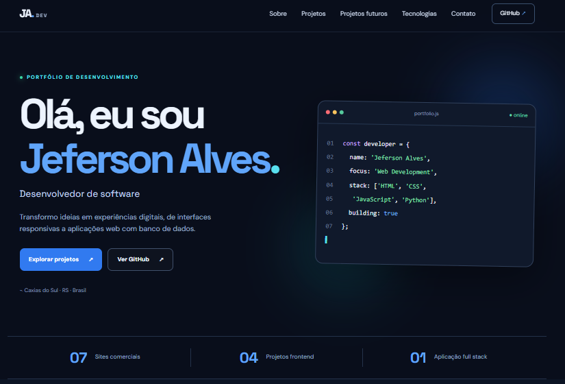
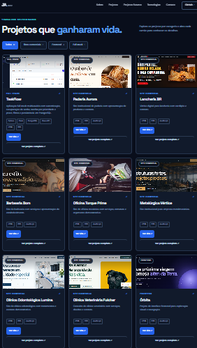
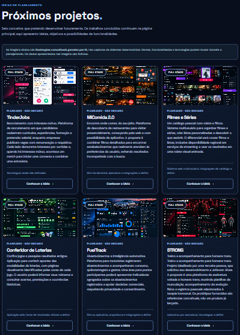

# Portfólio — Jeferson Alves

Portfólio pessoal desenvolvido com **HTML5, CSS3 e JavaScript**, com tema escuro, interface responsiva e navegação interativa. Reúne **18 projetos concluídos** — aplicações full stack, projetos frontend e sites comerciais demonstrativos — e **6 ideias de projetos futuros**.

O objetivo é apresentar minhas habilidades técnicas, meus trabalhos e minha evolução como desenvolvedor web.

### 🌐 [Acessar o portfólio online](https://jefersonalvesrs.github.io/portfolio-jeferson-alves/)

[](imagens/inicio.png)

_Página inicial do portfólio — clique na imagem para ampliar._

## ✨ Funcionalidades do portfólio

- Interface responsiva para desktop, tablet e celular.
- Menu de navegação adaptado para dispositivos móveis.
- Filtros dos projetos concluídos por categoria.
- Cards com imagens, descrições, tecnologias e links.
- Páginas individuais com informações, funcionalidades e galerias dos projetos.
- Área separada para projetos futuros, com descrições e imagens conceituais.
- Acesso às demonstrações, repositórios GitHub e currículo em PDF.
- Navegação com retorno ao topo e respeito à preferência por movimento reduzido.

## 🚀 Projetos concluídos

[](imagens/concluidos.png)

_Visão dos projetos concluídos — clique para ampliar._

### Full Stack

**TaskFlow — Gerenciador de tarefas**

Aplicação web com **Python, Flask e PostgreSQL**, banco de dados hospedado no **Supabase** e aplicação publicada na **Render**.

- Cadastro, login e gerenciamento de sessões.
- Criação, edição, conclusão, reabertura e exclusão de tarefas.
- Prioridades, prazos, filtros e identificação de tarefas atrasadas.
- Painel com indicadores.
- Recuperação de senha por e-mail com a API Brevo.
- Medidas de proteção como CSRF, consultas parametrizadas e limitação de tentativas.

**[Acessar TaskFlow](https://taskflow-5g4z.onrender.com/)**

### Frontend

| Projeto          | Descrição                                                                                        |
| ---------------- | ------------------------------------------------------------------------------------------------ |
| **CineVerse**    | Catálogo de filmes com busca, filtros, listas e roleta de seleção.                               |
| **Apex Motors**  | Catálogo automotivo com filtros, detalhes dos veículos e simulação ilustrativa de financiamento. |
| **Atlas Travel** | Descoberta de destinos com pesquisa, favoritos e planejamento demonstrativo de viagens.          |
| **Órbita**       | Experiência conceitual de turismo espacial, com exploração de destinos e reservas simuladas.     |
| **FoodSpot**     | Plataforma demonstrativa para descoberta de restaurantes e exploração de estabelecimentos.       |
| **FitZone**      | Site de academia com apresentação de modalidades e serviços.                                     |
| **CasaViva**     | Projeto frontend de apresentação de imóveis e navegação por opções.                              |
| **HotelLux**     | Site demonstrativo de hotel com apresentação de acomodações e serviços.                          |
| **GameHub**      | Interface de catálogo de jogos com exploração visual e navegação.                                |
| **FinanceFlow**  | Interface frontend de controle e visualização financeira.                                        |

### Sites comerciais demonstrativos

| Projeto                         | Descrição                                           |
| ------------------------------- | --------------------------------------------------- |
| **Lancheria BR**                | Cardápio, produtos e contato via WhatsApp.          |
| **Padaria Aurora**              | Apresentação institucional e catálogo de produtos.  |
| **Barbearia Dom**               | Serviços, preços e agendamento demonstrativo.       |
| **Oficina Torque Prime**        | Serviços automotivos e solicitação de orçamento.    |
| **Metalúrgica Vértice**         | Site institucional do setor metalmecânico.          |
| **Clínica Odontológica Lumina** | Apresentação de tratamentos e contato.              |
| **Clínica Veterinária Fulcher** | Serviços veterinários e informações institucionais. |

Os projetos comerciais demonstram soluções de interface e navegação para diferentes segmentos; formulários e solicitações não representam sistemas completos de atendimento ou pagamento.

## 💡 Projetos futuros

[](imagens/futuros.png)

_Conceitos visuais dos projetos planejados — clique para ampliar._

| Projeto                    | Ideia                                                                                                                                               |
| -------------------------- | --------------------------------------------------------------------------------------------------------------------------------------------------- |
| **TinderJobs**             | Plataforma de recrutamento com currículos, vagas, curtidas mútuas, matches e conversas para entrevistas.                                            |
| **MiComida 2.0**           | Descoberta de restaurantes por filtros combináveis de culinária, preço, distância, funcionamento e avaliações.                                      |
| **CineTrack**              | Catálogo de filmes e séries com listas personalizadas, filtros avançados, histórico, estatísticas e roleta.                                         |
| **Conferidor de Loterias** | Conferência de apostas, consulta de resultados históricos e identificação de premiações.                                                            |
| **FuelTrack**              | Registro de abastecimentos, consumo e despesas, com análises para motoristas e postos.                                                              |
| **STRONG**                 | Plataforma de treinos e acompanhamento físico para homens trans; ideia proposta por outra pessoa, com desenvolvimento planejado por Jeferson Alves. |

> **Importante:** estes seis projetos estão **planejados**, não concluídos. As imagens são **protótipos conceituais**, e as funcionalidades ainda poderão ser ajustadas durante o desenvolvimento.

## 🛠️ Tecnologias e ferramentas

**Portfólio:** HTML5, CSS3 e JavaScript.

**Tecnologias demonstradas nos projetos:** Python, Flask, PostgreSQL, SQL, integração com APIs, Git e GitHub.

**Ferramentas e serviços:** Visual Studio Code, GitHub Pages, Render, Supabase e Brevo.

## 📁 Estrutura do repositório

```text
portfolio-jeferson-alves/
├── index.html
├── style.css
├── script.js
├── projeto.html
├── projeto.css
├── projeto.js
├── projetos-dados.js
├── detalhes-projetos.js
├── futuros.html
├── futuro.html
├── futuros-dados.js
├── assets/
│   └── images/
│       ├── galerias/
│       ├── futuros/
│       └── imagens dos projetos
├── imagens/
│   ├── inicio.png
│   ├── concluidos.png
│   └── futuros.png
├── curriculo/
│   └── curriculo-jeferson-alves.pdf
└── README.md
```

## ▶️ Executar localmente

1. Clone o repositório:

   ```bash
   git clone https://github.com/JefersonAlvesrs/portfolio-jeferson-alves.git
   ```

2. Abra a pasta no Visual Studio Code.
3. Inicie o **Live Server** (ou outro servidor HTTP local).
4. Abra `index.html` e navegue pelo portfólio.

O portfólio é estático e não exige a instalação de dependências de backend.

## 🔗 Links

- 🌐 [Portfólio online](https://jefersonalvesrs.github.io/portfolio-jeferson-alves/)
- 💻 [GitHub](https://github.com/JefersonAlvesrs)
- 💼 [LinkedIn](https://www.linkedin.com/in/jeferson-alves-de-abreu/)
- 🚀 [TaskFlow](https://taskflow-5g4z.onrender.com/)

## 👨‍💻 Autor

**Jeferson Alves de Abreu**

Tecnólogo em Análise e Desenvolvimento de Sistemas, com foco em desenvolvimento web e interesse em oportunidades como desenvolvedor júnior.

Caxias do Sul — RS, Brasil.
